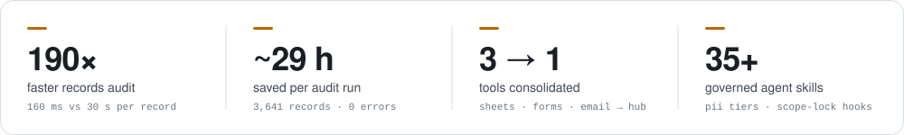
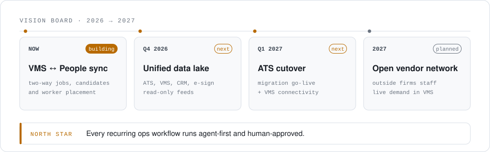

<picture>
  <source media="(prefers-color-scheme: dark)" srcset="./assets/header-dark.svg">
  <source media="(prefers-color-scheme: light)" srcset="./assets/header-light.svg">
  
</picture>

<br>

<!--NOW:START-->
```console
$ agent status
building    VMS and People tool two-way sync
shipping    Ops Hub modules for intake, POs and invoicing
next        Unified read-only data lake feeds
countdown   ATS cutover in 66 days
refreshed   2026-11-27 19:57 UTC
```
<!--NOW:END-->

### Selected work

| | Project | What it is | Signal |
|:-:|---|---|---|
| **01** | [**ILY VMS**](https://github.com/yamas-sst/ily-vms-case-study) | Multi-tenant vendor management system. Outside staffing firms and internal recruiters compete to fill live demand, with two-way sync into the People tool. | Vendor-scope isolation, Azure + Bicep, Claude API |
| **02** | [**Ops Hub**](https://github.com/yamas-sst/ops-hub-case-study) | Internal operations platform that retired shared spreadsheets, MS Forms and email chains. Job order intake, PO and invoice control, onboarding automation. | Company-wide adoption across sales, recruiting, onboarding, leadership |
| **03** | [**Data Integration Layer**](https://github.com/yamas-sst/data-integration-layer) | Read-only feeds from VMS, CRM, e-sign and ATS platforms into one data lake, plus the legacy ATS migration. | 190× faster records audit via endpoint discovery |

### Victories

<picture>
  <source media="(prefers-color-scheme: dark)" srcset="./assets/stats-dark.svg">
  <source media="(prefers-color-scheme: light)" srcset="./assets/stats-light.svg">
  
</picture>

### Stack

| Layer | Tools |
|---|---|
| **Languages** | `Python` `TypeScript` `JavaScript` `SQL` `HTML/CSS` `Bicep` `Office Scripts` |
| **Platforms** | `Azure Static Web Apps` `Azure OCR` `GitHub Actions` `Power Automate` `SharePoint` `M365` `Smartsheet` `Snowflake` |
| **APIs** | `Anthropic Claude` `OpenAI` `SAP Fieldglass` `HubSpot` `PandaDoc` `Avionte Bold` `Bullhorn` |
| **Agent tooling** | `Claude Code` `MCP servers` `Claude in Chrome` `Firecrawl` `Zapier` `Codex review` `Custom hooks + skills` |

### How I build

- **Read-only first.** Nothing writes to a source system until the read path is proven.
- **Secrets stay in the vault.** Never in code, prompts or logs.
- **Every agent run is gated.** Classified, PII-checked, and verified against a sample before it ships.
- **Humans approve, agents grind.** Automation takes the repetitive work, people keep the decisions.

### Vision board

<picture>
  <source media="(prefers-color-scheme: dark)" srcset="./assets/vision-dark.svg">
  <source media="(prefers-color-scheme: light)" srcset="./assets/vision-light.svg">
  
</picture>

<sub>Side build: a modern trade show directory, starting with the US and the skilled trades.</sub>

---

<sub>Building agentic systems for skilled trades staffing. Open to conversations on agent architecture, data platforms and ops automation.</sub>
